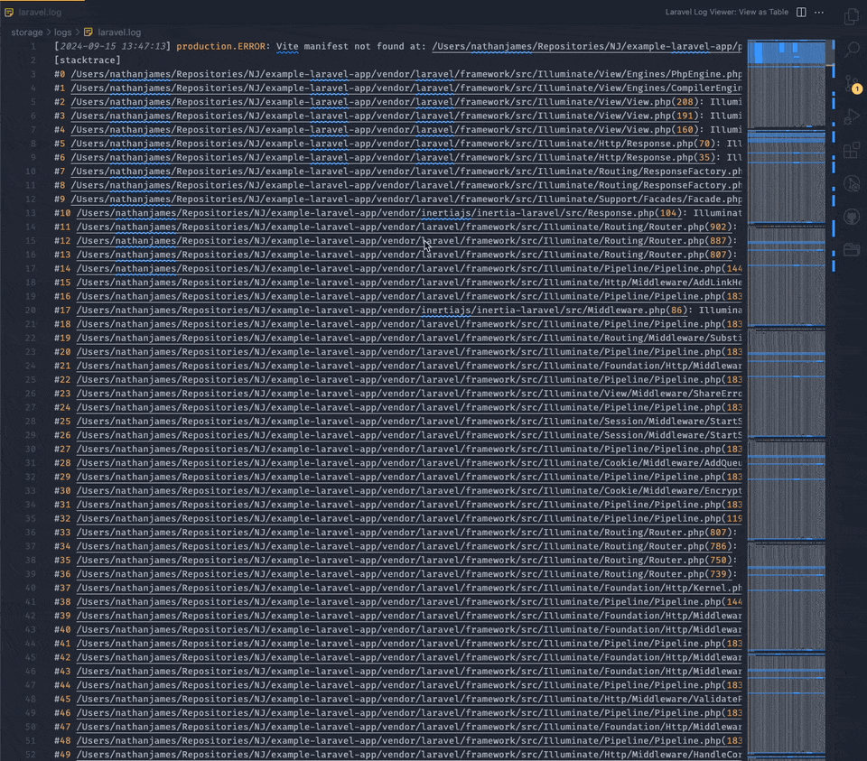

# Log to Table (Laravel & More)

View log files in a searchable, paginated table directly in VS Code. Laravel logs work out of the box, and custom named-group regex patterns can support other formats.

## Commands

- `Log to Table: Find and Open Log` finds `.log` files in the current workspace and lets you choose one.
- `Log to Table: View as Table` opens the active `.log` file in the table viewer.

## Features

- Laravel log parsing, including multiline stack traces.
- Timestamp, severity, and message filters.
- Pagination and full-message dialogs with optional wrapping.
- Refresh without reopening the viewer.
- Custom log formats saved across sessions.
- Large-file protection: only the final 5 MB is loaded.




## Custom Formats

Custom patterns must be safe regular expressions with the named groups `timestamp`, `severity`, and `text`.

For a comma-separated format:

```regex
^(?<timestamp>[^,]+),(?<severity>[^,]+),(?<text>.*)$
```

Saved names and patterns are stored in VS Code global state and included in Settings Sync when sync is enabled. Log contents remain local and are not transmitted by this extension.

## Compatibility

- VS Code 1.93 or newer.
- Desktop VS Code, including remote extension hosts with file-backed workspaces.
- Web-only environments such as vscode.dev are not currently supported.

## Development

Use Node.js 24 and npm.

```sh
npm ci
npm test
npm run package
```

`npm test` compiles, lints, and runs the extension tests. Set `VSCODE_VERSION=1.93.0` to test the minimum supported VS Code version; the default is current stable.

The `Run Extension` launch configuration starts an Extension Development Host for manual testing.

## Releasing

1. Update `CHANGELOG.md` and the version in `package.json`.
2. Run `npm test` and `npm run package`.
3. Publish with `npx vsce publish`.
4. Push a matching `vX.Y.Z` tag to create the GitHub release and attach its VSIX automatically.

## Support

Report bugs and feature requests on the [GitHub issue tracker](https://github.com/Nathanjms/log-to-table-extension/issues). For security reports, see [SECURITY.md](SECURITY.md).

## Changelog

See [CHANGELOG.md](CHANGELOG.md) for release history.
